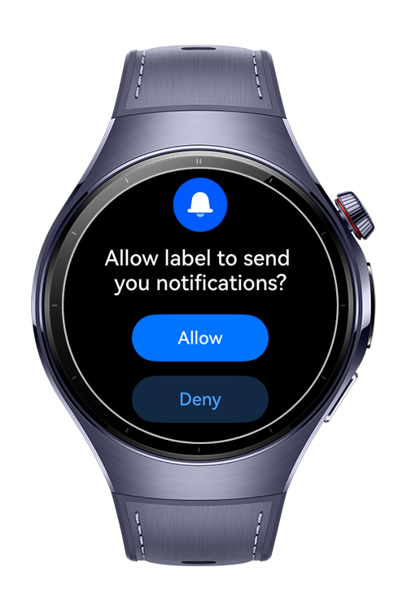
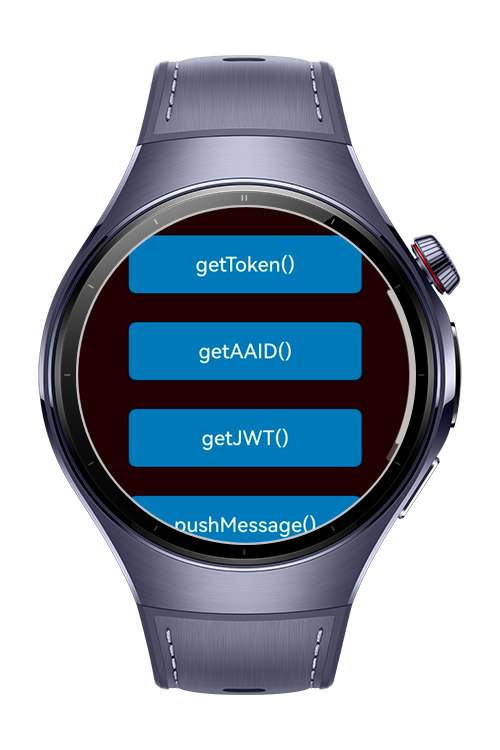
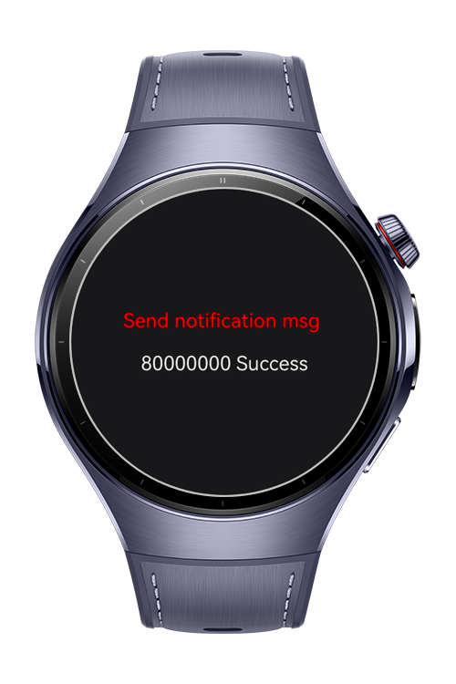
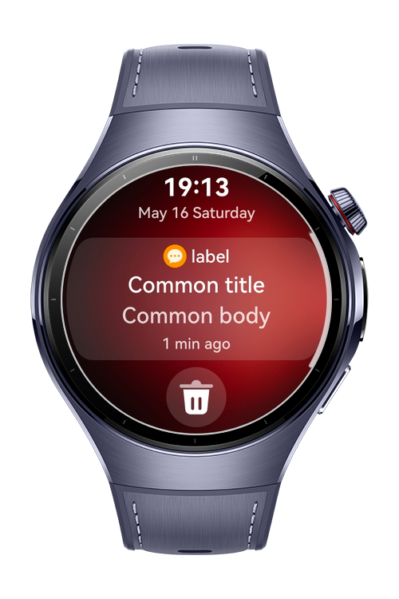

> **Note:** To access all shared projects, get information about environment setup, and view other guides, please visit [Explore-In-HMOS Index](https://github.com/Explore-In-HMOS/hmos-index).

# How to Build Smart Push Dispatcher

The `how_to_build_smart_push_dispatcher_on_watch` codelab demonstrates how to use HarmonyOS push kit on smart wearables.

# Preview

<div>
  
  
  
  
</div>

# Use Cases

- **getToken()**: You can see your device token.
- **getAAID()**: This API returns the result asynchronously through a promise.
- **getJWT()**: A service account is used for API authentication between servers. You can create a service account on
  the API Console of HUAWEI Developers, and then generate a JSON Web Token (JWT) in your app based on the public and
  private keys returned. With this JWT, your app can call Huawei public APIs that support service account-based
  authentication.
- **pushMessage()**: You can send a notification message.

# Tech Stack

- **Languages**: ArkTS / ArkUI
- **Frameworks**: HarmonyOS SDK 6.0.1(21)
- **Tools**: DevEco Studio(6.0.1)
- **Libraries**:
    - `@kit.BasicServicesKit`
    - `@kit.ArkUI`
    - `@kit.AbilityKit`
    - `@kit.PerformanceAnalysisKit`
    - `@kit.NotificationKit`
    - `@kit.PushKit`
    - `@kit.CryptoArchitectureKit`
    - `@kit.NetworkKit`
    - `@ohos.util`
    - `@kit.ImageKit`
    - `@kit.LocalizationKit`

# Directory Structure

```
entry/src/main/
|---ets/
|   |---abilities/
|   |   |---PushMessageAbility.ets   
|   |   |---RemoteNotificationExtAbility.ets   
|   |---component/
|   |   |---NavigationButton.ets 
|   |---entryability/
|   |   |---EntryAbility.ets          
|   |---entrybackupability/
|   |   |---EntryBackupAbility.ets
|   |---model/
|       |---ClickAction.ets
|       |---JWTHeader.ets       
|       |---JWTPayload.ets        
|       |---NotificationBody.ets  
|       |---Payload.ets
|       |---PushOptions.ets
|       |---PushRequestBody.ets
|       |---PushResponse.ets
|       |---Target.ets
|   |---pages/
|       |---AAID.ets
|       |---Index.ets       
|       |---JWT.ets        
|       |---PushMessage.ets  
|       |---PushToken.ets
|   |---utils/
|       |---Constants.ets
|   |---viewmodel/
|       |---HomeViewModel.ets
|---resources/
|   |---base/
|   |   |---element/
|   |   |   |---color.json            
|   |   |   |---float.json
|   |   |   |---string.json          
|   |   |---media/
|   |   |---profile/
|   |---dark/
|       |---element/
|           |---color.json            
|---module.json5                     
```

# Constraints and Restrictions

## Supported Devices

- Huawei Watch 5

## Work Conditions
- Apply for the required scenario specific message permission according to the message classification standards. Each message type has its own message classification standards, notification mode, and frequency control rules. (https://developer.huawei.com/consumer/en/doc/harmonyos-guides/push-gettingstart) (Note that, if your app only needs to push news and marketing messages, you do not need to apply for the self classification permission)
- Self classification application is not open to oversea yet.
- You need to create and download the key file of a service account to call Push Kit APIs on API Console. (https://developer.huawei.com/consumer/en/doc/harmonyos-guides/push-jwt-token) You can get the private.json file.

## Permissions

- ohos.permission.INTERNET

# License

**How to Build Smart Push Dispatcher** is distributed under the terms of the MIT License. See the [LICENSE](LICENSE) for more information.
